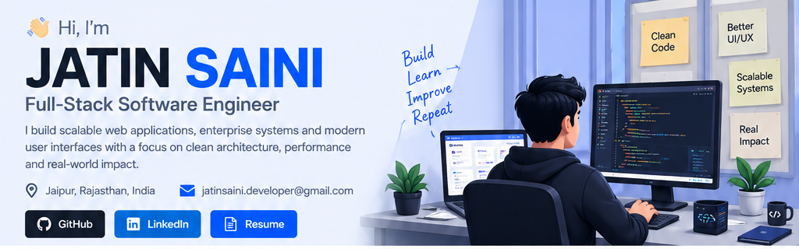
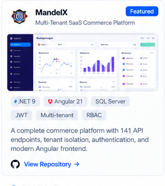
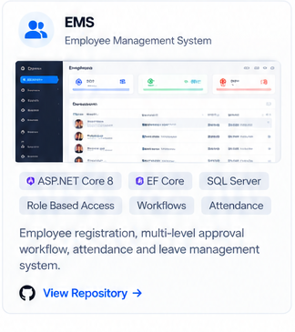
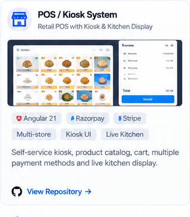

  
  
  

**Full-Stack Software Engineer** · **ASP.NET Core** · **Angular** · **SQL Server**

*Building reliable enterprise software, multi-tenant SaaS platforms, and polished web applications.*

📍 Jaipur, Rajasthan, India · ✉️ [jatinsaini.developer@gmail.com](mailto:jatinsaini.developer@gmail.com)

---

## ⚡ At a Glance

<table>
  <tr>
    <td align="center" width="20%">
      
       Engineering & learning
    </td>
    <td align="center" width="20%">
      
       Projects & experiments
    </td>
    <td align="center" width="20%">
      
       MandelX platform
    </td>
    <td align="center" width="20%">
      
       Platform contributions
    </td>
    <td align="center" width="20%">
      
       Build · Learn · Improve
    </td>
  </tr>
</table>

## 🧰 Tech Stack

  
   
  
   
  

<table>
  <tr>
    <td width="50%" valign="top">
      <h3>⚙️ Backend</h3>
      ASP.NET Core Web API & MVC · .NET · Blazor · Entity Framework Core · Dapper · ADO.NET · LINQ · SignalR · Windows Services
    </td>
    <td width="50%" valign="top">
      <h3>🖥️ Frontend</h3>
      Angular · TypeScript · React · RxJS · Angular Material · Bootstrap · AG Grid · Chart.js · Responsive UI
    </td>
  </tr>
  <tr>
    <td width="50%" valign="top">
      <h3>🗄️ Databases</h3>
      SQL Server · MySQL · Relational Modelling · Stored Procedures · Indexing · Query Optimization · EF Core Migrations
    </td>
    <td width="50%" valign="top">
      <h3>🔐 Security & Architecture</h3>
      JWT · Refresh-token rotation · API-key authentication · RBAC · TOTP 2FA · BCrypt · Multi-tenant SaaS · SOLID · Caching
    </td>
  </tr>
  <tr>
    <td width="50%" valign="top">
      <h3>🔌 Integrations</h3>
      Microsoft Dynamics NAV · Stripe · Razorpay · SMTP / MailKit · Excel import-export · AWS S3
    </td>
    <td width="50%" valign="top">
      <h3>🚀 DevOps & Tools</h3>
      Azure DevOps CI/CD · Git · GitHub · Docker · Swagger / OpenAPI · Postman · Serilog · Hangfire
    </td>
  </tr>
</table>

## 💼 Professional Experience

### Software Engineer — DBLB Tech
**Gurugram, Haryana (Remote) · December 2025 – Present**

- Deliver end-to-end features for a multi-tenant retail POS/ERP platform built with ASP.NET Core, Angular, EF Core, Dapper, and SQL Server.
- Built a self-service kiosk flow with product tiles, cart, add-ons, checkout, payment-gateway integrations, and a live kitchen display.
- Implemented permission-controlled warehouse shipment and receipt workflows, including invoice short-close for partially delivered orders.
- Improved inventory integrity with validation around bin lookups, batch-tracked stock, and stock transfers.
- Created a reusable document-template engine for invoices, shipments, and other business documents.
- Integrated Microsoft Dynamics NAV through .NET Windows Services to synchronize vendor, bank, address, gate-entry, and purchase-order data.
- Built management dashboards and vendor-onboarding workflows with bulk Excel import/export.

### Instructor, Computer Science — Poddar College
**Bharatpur, Rajasthan · December 2025 – April 2026**

- Taught Web Development, Software Engineering, and Computer Networks to approximately 90 BCA students.
- Prepared lesson plans and practical labs covering HTML, CSS, JavaScript, and SDLC fundamentals.

## 🚀 Featured Projects

<table>
  <tr>
    <td width="33%" valign="top">
      <h3 align="center">MandelX</h3>
      
Multi-Tenant SaaS Commerce Platform

      
      

        
        
        
      

      <ul>
        <li>141 REST API endpoints across 30 controllers.</li>
        <li>Tenant-scoped data isolation and automated provisioning.</li>
        <li>RBAC, refresh-token rotation, TOTP 2FA, and tenant-level rate limiting.</li>
        <li>130-entity domain across catalog, sales, and warehouse operations.</li>
      </ul>
      
<a href="MANDELX_REPOSITORY_URL">View Repository →</a>

    </td>
    <td width="33%" valign="top">
      <h3 align="center">EMS</h3>
      
Employee Management System

      
      

        
        
        
      

      <ul>
        <li>Configurable multi-level employee-registration approval workflow.</li>
        <li>HR, Manager, and Employee roles with authentication enforcement.</li>
        <li>Attendance and leave modules with automatic balance deduction.</li>
      </ul>
      
<a href="EMS_REPOSITORY_URL">View Repository →</a>

    </td>
    <td width="33%" valign="top">
      <h3 align="center">POS / Kiosk System</h3>
      
Retail POS and Kitchen Display

      
      

        
        
        
      

      <ul>
        <li>Self-service kiosk, product catalog, cart, and checkout.</li>
        <li>Store- and tenant-configurable payment options.</li>
        <li>Live kitchen display and warehouse workflow integrations.</li>
      </ul>
      
<a href="POS_REPOSITORY_URL">View Repository →</a>

    </td>
  </tr>
</table>

### More Projects

- Library Management web application
- React and TypeScript applications
- Interactive JavaScript and SCSS experiences
- C++ data-structures and problem-solving projects

## 📈 GitHub Stats

  
  

  

## 🎓 Education

**B.Tech — Computer Science & Engineering**  
Government Engineering College, RTU Kota · October 2021 – June 2025  
**CGPA:** 7.0 / 10

## 🤝 Let's Connect

  
  
  

I'm interested in scalable business applications, secure backend systems, full-stack engineering, and SaaS products.

---

**Build thoughtfully · Ship reliably · Keep learning**

Thanks for visiting my profile.

